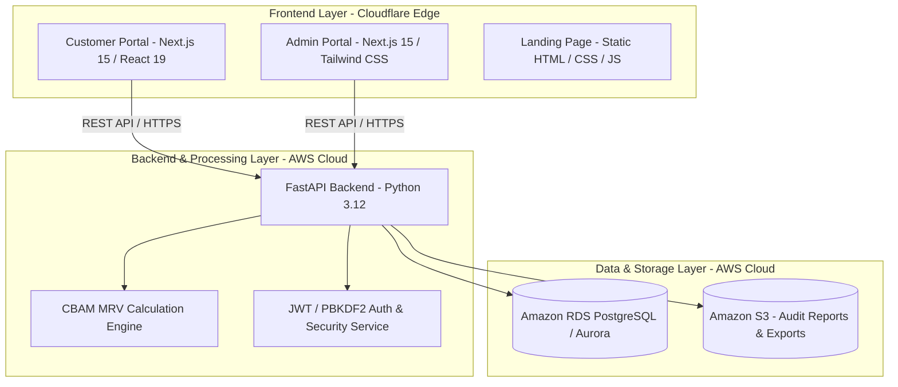

# Technical Specifications: System Development Tools, Techniques & System Environment

---

## 1. System Development Tools and Techniques

**System Development Tools and Techniques** encompasses the programming languages, software frameworks, databases, APIs, algorithms, and architectural patterns utilized to design, build, test, and maintain the system.



---

### 1.1 Programming Languages
| Language | Version / Specification | Scope & Usage |
| :--- | :--- | :--- |
| **TypeScript** | 5.0+ | Frontend logic, strict type-checking, form schemas, and UI state management |
| **Python** | 3.12+ | Backend REST API, CBAM calculation engine, and automated outreach pipelines |
| **JavaScript / HTML5 / CSS3** | ES6+ / HTML5 / CSS3 | High-speed static landing page, micro-interactions, responsive styling |
| **SQL** | PostgreSQL 15+ Dialect | Relational schema definitions, views, indexing, migrations, and transactional queries |

---

### 1.2 Frameworks, Runtimes & Libraries
* **Frontend Web Applications (Deployed on Cloudflare):**
  * **Next.js 15 (React 19):** Full-stack framework deployed on Cloudflare Pages via `@opennextjs/cloudflare` runtime.
  * **Tailwind CSS v4 & PostCSS:** Utility-first CSS framework for design systems and responsive layouts.
  * **Lucide React:** Iconography library for UI components.
  * **jsPDF & ExcelJS:** In-browser document and spreadsheet generation for downloadable compliance audit sheets.
  * **Zod:** Declarative schema validation for user inputs and API response contracts.
* **Backend API & Processing (Deployed on AWS):**
  * **FastAPI (0.111+):** Asynchronous web framework built on the ASGI standard for high-throughput API endpoints.
  * **Uvicorn:** Production-grade ASGI web server.
  * **SQLAlchemy 2.0 & Alembic:** Object Relational Mapper (ORM) and automated database schema migration manager.
  * **Pydantic v2:** Fast data parsing, validation, and automated OpenAPI (Swagger) documentation generation.
* **Testing & Quality Assurance:**
  * **Vitest & Fast-Check:** Frontend unit and property-based calculation testing.
  * **Playwright:** End-to-end (E2E) browser automation and UI workflow testing.
  * **Pytest & Ruff:** Python test runner, linter, and static code analyzer.

---

### 1.3 Database & Storage Technologies
* **Primary Relational Database:** **Amazon RDS for PostgreSQL** (or Amazon Aurora Serverless v2 PostgreSQL).
* **Connection Pooling:** **AWS RDS Proxy** or internal database connection pooling (`asyncpg` / `psycopg3`).
* **Object Storage:** **Amazon S3** for secure, durable storage of generated CBAM declarations, PDF reports, and compliance attachments.

---

### 1.4 APIs, Protocols & 3rd-Party Integrations
* **Application APIs:** RESTful JSON APIs adhering strictly to OpenAPI (Swagger 3.0) standards.
* **Authentication & Authorization:** Stateless **JWT (JSON Web Tokens)** with HMAC-SHA256 signature verification for authenticated sessions.
* **Outreach & Communication:** **Resend REST API** for transactional email delivery and customer discovery notifications.
* **External Integration Hooks:**
  * **Calendly / Cal.com API:** Founder discovery call scheduling.
  * **Google Apps Script / Webhooks:** Synchronizes waitlist submissions to CRM spreadsheets.

---

### 1.5 Algorithms & Core Processing Logic
* **EU CBAM MRV Calculation Engine:**
  * Implements Direct Emissions ($AttrEm_{dir}$) and Indirect Emissions ($AttrEm_{indir}$) calculation models per metric ton of steel/aluminum in accordance with **EU Regulation 2023/956** and Implementing Regulation **2023/1773**.
  * Fallback algorithm using EU sectoral default values when primary supplier data is missing.
  * Arbitrary-precision math via `decimal.js` (frontend) and Python’s `decimal.Decimal` (backend) to prevent floating-point rounding errors during audits.
* **Cryptographic & Security Algorithms:**
  * **PBKDF2 / Argon2:** Password hashing with unique per-user salts.
  * **CSPRNG (Cryptographically Secure Pseudo-Random Number Generator):** Generates 256-bit entropy tokens for **Supplier Smart Links (`/s/[token]`)**, enabling passwordless, frictionless emissions reporting.

---

### 1.6 Architectural Patterns
* **Hybrid Cloud Architecture (Cloudflare + AWS):** Edge-rendered frontend on **Cloudflare Pages** communicating securely with containerized backend services on **AWS**.
* **Layered Service-Repository Pattern:**
  $$\text{Routers (HTTP)} \longrightarrow \text{Services (MRV Rules Engine)} \longrightarrow \text{Repositories (Data Access)} \longrightarrow \text{PostgreSQL}$$
* **Zero-Trust Supplier Portal Pattern:** Suppliers access targeted data entry forms via scoped, single-use, or time-limited tokens without requiring full account registration.

---

## 2. System Environment (Cloudflare + AWS Infrastructure)

**System Environment** specifies the cloud hosting platforms, operating system requirements, hardware specifications, network topologies, and security configurations required to run and access the system.

```mermaid
graph LR
    User[Clients: Web Browser / Mobile] -->|HTTPS / TLS 1.3| CF_Edge[Cloudflare Global Anycast Edge Network]
    
    subgraph Cloudflare Platform
        CF_Edge -->|Edge Serving / SSR| CF_Pages[Cloudflare Pages: Next.js 15 Portals]
    end
    
    CF_Edge -->|API Reverse Proxy / Custom Domain| AppRunner[AWS App Runner / ECS Fargate: FastAPI Backend]
    
    subgraph AWS Cloud Platform
        subgraph AWS Virtual Private Cloud (VPC)
            AppRunner -->|PostgreSQL Protocol| RDS[(Amazon RDS PostgreSQL)]
            AppRunner -->|Audit Exports / Files| S3[(Amazon S3: Compliance Documents)]
            AppRunner -->|Credentials & Keys| SM[AWS Secrets Manager]
            AppRunner -->|System Logs & Alarms| CW[Amazon CloudWatch]
        end
    end
```

---

### 2.1 Deployment Environment & Cloud Infrastructure
| Component | Hosting Platform | Description & Deployment Method |
| :--- | :--- | :--- |
| **Frontend Applications** | **Cloudflare Pages** | Next.js 15 applications deployed to Cloudflare's global edge network using `@opennextjs/cloudflare` and Wrangler with automated Git-based CI/CD |
| **Edge DNS & CDN** | **Cloudflare DNS & CDN** | Anycast DNS, edge caching, automated SSL/TLS termination, and DDoS protection |
| **Backend API Service** | **AWS App Runner** *(or Amazon ECS on AWS Fargate)* | Fully managed containerized runtime executing the Dockerized FastAPI application with automatic scaling |
| **Container Registry** | **Amazon ECR** | Private Docker image registry on AWS for backend versioning and deployment |
| **Database Server** | **Amazon RDS for PostgreSQL** | Managed PostgreSQL (v15+) configured with Multi-AZ, automated backups, and encrypted storage |
| **Object Storage** | **Amazon S3** | Encrypted bucket for storing generated CBAM reports, Excel files, and supporting documents |
| **Secret Management** | **AWS Secrets Manager / SSM Parameter Store** | Centralized storage and automatic rotation of DB connection strings and JWT signing keys |
| **Observability & Logging** | **Amazon CloudWatch** | Centralized log ingestion, performance metrics, and real-time alerting for AWS resources |

---

### 2.2 Operating System & Runtime Requirements
* **Frontend Runtime (Cloudflare):** V8 isolate-based Serverless Edge Runtime (Cloudflare Workers / Pages).
* **Production Server / Container OS (AWS):** Linux (`python:3.12-slim` based on Debian 12 / Alpine Linux x86_64 or ARM64).
* **Container Runtime:** Docker Engine 24.0+ / OCI-compliant container managed by AWS App Runner / Fargate.
* **Client / End-User Operating Systems:**
  * **Desktop OS:** Windows 10/11, macOS 12+, Ubuntu 22.04+ (or any modern Linux distribution).
  * **Mobile OS:** iOS 16+, Android 12+.
  * **Supported Web Browsers:** Google Chrome 110+, Apple Safari 16+, Mozilla Firefox 110+, Microsoft Edge 110+.

---

### 2.3 Hardware & Compute Sizing Specifications

#### A. Frontend Edge (Cloudflare Pages)
* **Compute Model:** Globally distributed edge execution (Serverless V8 Isolates).
* **Cold Start Latency:** $< 5 \text{ ms}$ global cold starts.
* **Concurrency:** Automatically scales to millions of requests without manual provisioning.

#### B. Backend Compute Sizing (AWS App Runner / ECS Fargate)
| Resource | Minimum (Development / MVP) | Recommended (Production / Scaled) |
| :--- | :--- | :--- |
| **vCPU** | 0.5 – 1 vCPU | 1 – 2 Dedicated vCPUs |
| **Memory (RAM)** | 1 GB RAM | 2 GB – 4 GB RAM |
| **Auto-scaling Policy** | 1 instance (Min = 1, Max = 2) | 1 to 5 instances (scales automatically on concurrency/load) |

#### C. Database Sizing (Amazon RDS for PostgreSQL)
| Resource | Minimum (Development / MVP) | Recommended (Production / Scaled) |
| :--- | :--- | :--- |
| **Instance Type** | `db.t4g.micro` or `db.t4g.small` (Graviton2) | `db.t4g.medium` or Aurora Serverless v2 (0.5 – 4 ACUs) |
| **vCPU / Memory** | 2 vCPU / 1–2 GB RAM | 2 vCPU / 4 GB RAM |
| **Storage Capacity** | 20 GB GP3 SSD | 50–100 GB GP3 SSD (with Storage Auto-scaling enabled) |

#### D. Client / End-User Hardware
* **Processor:** 1.6 GHz Dual-Core 64-bit or ARM processor.
* **Memory (RAM):** 4 GB RAM minimum (8 GB recommended for in-browser PDF report rendering).
* **Screen Resolution:** Fully responsive from 375px (Mobile) to 1920x1080 (FHD Desktop).

---

### 2.4 Network, Edge Routing & Security Requirements
* **Edge Routing & SSL:**
  * **Cloudflare Anycast DNS & Universal SSL:** Delivers ultra-low latency routing and automated **TLS 1.3 / HTTP/3** support on **Port 443**.
  * **Backend Custom Domain:** Configured via Cloudflare CNAME pointing to AWS App Runner / ALB endpoint with AWS Certificate Manager (ACM) integration.
* **VPC & Database Isolation:**
  * Backend containers and RDS reside inside an **Amazon Virtual Private Cloud (VPC)**.
  * **Security Groups:** PostgreSQL (Port 5432) accepts inbound traffic *only* from the Backend Security Group; no public IP is assigned to the database.
* **Application Security & WAF:**
  * **Cloudflare WAF & DDoS Protection:** Layer 3/4/7 automated DDoS mitigation and bot management at the edge.
  * **CORS Policy:** Strict Cross-Origin Resource Sharing rules allowing requests exclusively from verified frontend domains hosted on Cloudflare Pages.
  * **Security Headers:** Enforced `Strict-Transport-Security (HSTS)`, `X-Content-Type-Options: nosniff`, and `Content-Security-Policy (CSP)`.
