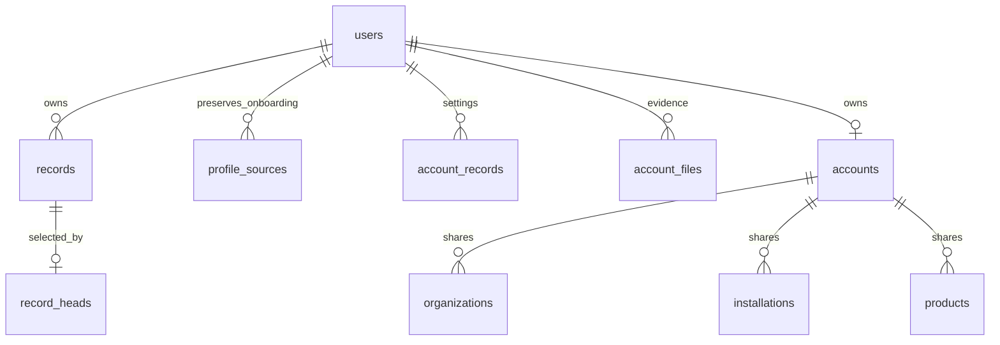

# Compact database for certrace-new workflows

The active Prisma schema is **37 models / 571 lines**, replacing the previous 11,729-line draft. Migration [`202610270001_compact_reports`](../../certrace-backend/prisma/migrations/202610270001_compact_reports/migration.sql) replaces the generated form tables with JSONB documents. The earlier unshipped 73-table verification draft has been removed. The later additive migration `202610280001_r2_files` adds private object-storage references to the two file tables; see [R2 setup and file migration](../R2-STORAGE.md).

The user explicitly authorized discarding old report/verification inputs while requiring preservation of user and onboarding data. `certrace-new` is a read-only reference. Its 13 application tables do not persist most verification workflows; those still use browser storage. Our database supplies durable storage for those documents.

## Physical design

| Area | Models | Purpose |
| --- | ---: | --- |
| `public` | 20 | Existing users, authentication, consent, declarations, links, files, settings, calculations and operational services. Includes the historical `alembic_version` tracking table. |
| `masterdata` | 13 | Existing account membership and shared company, installation and product identities/versions. These are used by the current backend and include company history relevant to onboarding. |
| `reporting` | 4 | Complete revision documents, selected revisions, legacy-import receipts and protected onboarding source copies. |
| **Total** | **37** | 36 application models plus the historical Alembic tracker. Prisma's own migration tracker is additional. |

The four reporting tables are:

- `records`: `id`, `user_id`, `key`, `revision`, `value` (JSONB), `is_null`, `updated_at`, `sealed`. Each save creates a new revision. A sealed revision cannot change.
- `record_heads`: selects the active revision for each account and document key. The composite foreign key prevents selecting another account's document.
- `migration_receipts`: retains provenance for explicit legacy imports.
- `profile_sources`: read-only source copies of onboarding values from both legacy JSON and the old typed history, with source, revision, timestamp and whether that source was selected.



Nested fuel rows, emissions, process details, sector fields and lists remain within their JSON document. There is no table per field or nested list. JSONB preserves object fields, ordered arrays, duplicate answers, explicit null, empty values, booleans and zero. Object property order is not significant. IDs, ownership, revision selection and shared entity relationships retain SQL constraints; application validators enforce the document's fields and workflow rules.

The current reporting API remains functional through the updated document storage adapter. It keeps validation, account isolation, concurrent-save checks, supplier scope checks, atomic batches and immutable history. Shared master edits continue to update related current documents without rewriting frozen history. The reference frontend and its new field validators still need their planned API/UI port; a storage round trip does not claim those new screens are already integrated.

## Reference workflow mapping

| Reference function | Durable destination |
| --- | --- |
| Installations, suppliers and workspaces | Account-scoped `records` documents; existing shared identities where applicable |
| Methodology draft and publications | `records`, retaining complete nested methodology and version documents |
| Monthly production, fuels, electricity, gases, processes and sector details | `records` monthly document |
| Precursors and their history | `records` precursor documents |
| Evidence metadata | `records`; original bytes in existing file tables |
| Carbon price, monthly requests/reviews, workspace drafts, pack sign-off | `records` documents |
| Internal precursor links, unit costs and other account stores | Existing revision-checked `account_records`; can move into `records` when their reference API validators are ported |
| Users, consent, sessions, password resets, billing flags | Existing account/authentication tables |
| Onboarding answers | `records` under `certrace:profile`, with immutable migration source copies |

The frozen source-contract fixture covers all 15 previously audited verification types. The rehearsal writes every reference shape to real PostgreSQL JSONB and checks the recovered value, including new nested fields. It is test data, not another database schema or a production dependency on the ignored reference directory.

## Protected user and onboarding data

The migration does not update `users`, credentials, Google IDs, plan/trial fields, suspension state, sessions, consent, account memberships or shared company history. It preserves all existing typed profile revisions and the selected head, including an older selected revision. Future saves allocate a revision after the highest retained revision.

The 20 questionnaire/profile fields are `firstName`, `lastName`, `jobTitle`, `companyName`, `sector`, `installationId`, `jurisdiction`, `currency`, `unit`, `onboarded`, `goalAchieve`, `currentManagement`, `biggestChallenge`, `cbamProductCount`, `supplierCount`, `installationCount`, `customerCount`, `hearAbout`, `phone`, and `lineId`.

Company name and jurisdiction are read from each profile's **pinned organization version**, not the latest company head. Count bands and phone/LINE answers remain strings. Answer arrays preserve their order and duplicates. Missing answers, null, empty lists and incomplete onboarding remain distinct. `users.onboarded` and the profile's `onboarded` value remain independent.

When typed and legacy profiles coexist, the selected typed profile stays active and the complete legacy value is kept in `profile_sources`. A legacy-only account gets its existing document, revision and timestamp as its active profile. Old session projections (`id`, `email`, `googleLinked`, `planId`, `trialStartedAt`) remain in the raw stored history/source copy; the editable profile API filters them so authentication stays authoritative and questionnaire edits still work. No migration sends registration-sheet updates, email or notifications. Malformed typed profile roots abort the entire transaction before deletion.

## Removed and retained data

After profile reconstruction and assertions, the migration removes non-profile typed report revisions and their heads, known legacy report keys from `account_records`, and the 430 registered form/catalogue tables. Old questionnaire child tables are removed only after their values have been copied and checked.

Existing public declaration documents, original files, links, user settings and shared master identities are retained. This migration resets the old typed verification inputs; it does not erase every public service table. The user allowed old report data to be discarded, so no report backfill or archive is required. The separate onboarding archive is mandatory.

The nine earlier SQL migrations remain unchanged, followed by the compact migration. Existing installations apply only pending migrations; fresh installations apply the complete chain. These files retain the database's upgrade history and must not be deleted or rewritten. Their source length is migration history, not the active schema size.

Obsolete SQL generation has been removed. `db:report-catalogue` checks only the current document validators, report sections, storage keys and autofill reference data; it cannot regenerate historical migrations. Historical decoders and preservation fixtures remain necessary to verify the onboarding upgrade. New database changes require a new migration.

## Verification

Run `bun --no-env-file run test:verification-schema` from the repository root. It creates a uniquely named PostgreSQL container with synthetic data, derives its loopback port from Docker, verifies a unique database marker, and gives backend tests an explicit environment with `.env` loading disabled. It never uses the application's configured database URL.

Checks include failed-migration rollback; legacy-only/typed/overlapping profiles; pinned old company versions; all questionnaire fields; duplicate/absent/empty/null answers; user/auth/shared-table equality; existing password login; profile reads and edits after selecting an older revision; migration retry; all 15 reference document shapes; RLS and sealed revisions; Prisma schema agreement; and the complete backend suite.

The preservation audit SQL is a read-only manifest of protected user/shared tables for before/after comparison. It deliberately excludes the report tables and migrated profile source tables. The rehearsal's independent old decoder verifies onboarding values separately.

## Production deployment

**Deploy this migration together with the matching backend release.** The old backend cannot run against the compact storage. Unlike the withdrawn additive draft, running only the migration while leaving the old backend running is not a supported rollout.

1. Build/publish the migrate, backend and frontend images for the same reviewed release tag.
2. On the production host, pull that tag, then stop the backend/frontend to prevent writes.
3. Take a full PostgreSQL backup and confirm it is readable. Keep its filename and the previous image tag for recovery.
4. Run the migration container and inspect its exit status/logs. Start the matching backend/frontend only after success.
5. Check login, existing onboarding answers and a profile save. Reload verification: the old typed report inputs have been reset.

Typical commands after selecting the release tag in production `.env`:

```sh
docker compose -f docker-compose.yml pull
docker compose -f docker-compose.yml stop frontend backend
# Save a uniquely named backup with pg_dump before proceeding.
docker compose -f docker-compose.yml run --rm migrate
docker compose -f docker-compose.yml up -d backend frontend
```

Keep the existing database volume. Do not use `down -v`, `migrate reset`, or `db push`. Recovery after a successful destructive migration uses the database backup and previous release together; reverting just the application image will not recreate the removed tables. The user reported deploying the compact migration to production. The additional local invitation migration was removed after the user clarified that no features beyond the reference should be added. No additional production migration is required for the contact roster.
