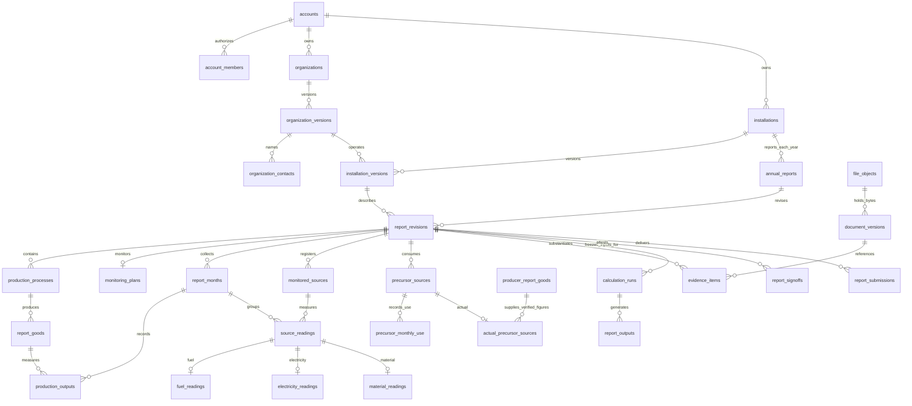

# Proposed report database in third normal form

> Implementation status: shared company, installation, product and annual-report identities are now implemented. See [the executable model and verification](IMPLEMENTATION.md), [actual input columns](IMPLEMENTED-COLUMNS.md), and migration 006 for the deployed table names. The SQL in this document remains the conceptual reference and must not be applied as an extra migration.

This design covers all **218 numbered input references** in [the report input structure](../CBAM-NUMBERED-INPUT-STRUCTURE.md). It replaces the report aggregates currently stored in `account_records.value` with domain tables. It uses PostgreSQL types and foreign keys that Prisma can represent. Authentication, billing, notifications, and declaration workflow remain outside this redesign.

- [Field-by-field storage map](INPUT-MAPPING.md): every reference from 0.1 through 2.7.17.
- [Proposed SQL schema](reporting-3nf.sql): tables, keys, constraints, views, and representative integrity triggers in a separate `reporting` namespace.
- [Schema validation fixtures](validate-design.sql): isolated checks of the proposed constraints.

## The report boundary

There is **one annual report for one installation and one year**. Its products and processes share the same monitoring dataset. Creating a declaration for another buyer must reference the existing report; it must not create another independent copy of the installation's readings.

An annual report has numbered revisions. A draft revision can be edited. A submitted revision is locked. A correction creates another revision with a reason and a link to the previous revision. OER, OSER, and a conditional electricity addendum are outputs of a revision, not three independent input datasets.

Company and installation facts are shared identities with versioned profiles. A report revision points to the exact installation version, and that version points to the exact operator version. Updating next year's address therefore does not rewrite an older signed report.

The diagram shows the main relationships. The SQL contains the child and junction tables for instruments, composition, allocations, calibrations, gaps, receipts, disclosures, and reviews.

## Storage by business entity

| Area | Main tables | What owns the facts |
|---|---|---|
| Account access | `accounts`, `account_members` | An account can have several authorized users; a user is not the business entity. |
| Operator | `organizations`, `organization_versions`, `organization_contacts`, `monitoring_responsibilities`, `organization_relationships` | Legal identity, address, country, contact, responsibilities, and exporter relationships. |
| Installation | `installations`, `installation_versions`, `installation_other_goods` | Stable reference plus versioned location, representative, and Registry ID. |
| Annual dataset | `annual_reports`, `report_revisions` | Unique installation/year; revision status, monitoring dates, correction history. |
| Process/product | `production_processes`, `process_routes`, `process_steps`, `report_goods`, `good_routes`, `good_equipment` | Process facts are stored on the process; product facts on the product. |
| Composition | `good_compositions`, `steel_parameters`, sector observation tables | Composition belongs to a specific good. Steel parameters have dedicated typed columns. Additional scientific parameters use a controlled catalogue with a fixed value type and unit. |
| Monitoring method | `monitoring_plans`, `monitored_sources`, `source_stream_methods`, `instruments`, `instrument_calibrations`, `data_gaps` | Sources, instruments, calibrations, and gaps are individual records. |
| Monthly data | `report_months`, `production_outputs`, `source_readings`, typed reading tables | Each reading references a source and month; repeated fuels and outputs are child rows. |
| Allocation and transfers | `source_process_allocations`, `electricity_good_usage`, `transfer_balances`, `co2_transfers` | Attribution and transfers retain their process/product references and quantities. |
| Precursors | `precursor_sources`, four source subtype tables, `precursor_consuming_goods`, `precursor_monthly_use`, `precursor_receipts` | Supplier, producer, purchase receipt, and consumption are separate facts. |
| Producer evidence | `producer_reports`, `producer_report_goods`, `verification_reports`, `verifier_accreditations`, `accreditation_scopes` | A verified producer report can support several sources without copying its issuer, coverage, or emissions figures. |
| Documents | `file_objects`, `documents`, `document_versions`, `evidence_items`, evidence binding tables | Original bytes, document ownership, document versions, and the figures they support have separate lifecycles. |
| Extraction review | `extraction_runs`, `extraction_candidates` | AI suggestions, page citations, acceptance, and replacement confirmation. Accepted data is written to the appropriate typed input table in the same transaction. |
| Report review | `annual_reviews`, `annual_verification_reports`, finding/response/status tables | Internal review and the independent verifier's report are separate records. |
| Electricity addendum | `electricity_declarants`, `electricity_addenda`, `addendum_evidence`, `addendum_deliveries` | Declarant identity/EORI, eligibility, electricity quantity, and actual delivery. |
| Carbon-price claim | `carbon_price_claims`, `carbon_price_adjustments`, `carbon_price_evidence` | Amount, currency, instrument, covered share, adjustments, and receipts. These do not replace specific embedded free allocation. |
| Calculations and output | `calculation_runs`, typed result tables, `calculation_findings`, `report_outputs` | Results identify the frozen input revision, engine version, and regulatory release. |

## Why this is 3NF

The design removes repeating groups, dependencies on only part of a key, and duplicated attributes that belong to another entity.

1. **First normal form:** a source, product, instrument, calibration, receipt, or evidence binding is one row. No operational field is an array of objects or an editable report JSON blob. Explanations remain text because they are single narrative facts.
2. **Second normal form:** a monthly use quantity depends on its full key: `(revision_id, source_key, month, process_key)`. Source name and producer address are not repeated on each quantity row.
3. **Third normal form:** a product references a process rather than copying its name; an actual precursor source references a producer-report good rather than copying its verified intensities and verifier details. Reading rows reference source identities. Foreign keys provide those other facts through joins.

Examples of functional dependencies:

| Key | Attributes determined by the key | Facts deliberately stored elsewhere |
|---|---|---|
| `(installation_id, reporting_year)` | Annual report identity | Installation name/address, which belong to an installation version. |
| `(report_id, revision_no)` | Monitoring window, revision state, pinned installation version | Operator name and country, which belong to the operator version. |
| `(revision_id, good_key)` | Product name, description, CN code, process reference, output unit | Process name/routes/steps. |
| `(revision_id, reading_key)` | Source and month | Source type/name and the source's instrument records. |
| `(revision_id, source_key, month, process_key)` | Precursor tonnes used | Producer report, verification issuer, accreditation. |
| `(revision_id, composition_key, parameter_code)` | A scientific observation's value | Parameter name, value type, unit, and legal reference, which belong to the parameter definition. |
| `document_version_id` | Original filename, file object, document version and issue/expiry dates | File content and hash, which belong to the file object. |

Local keys such as `good_key` and `source_key` are only unique inside a revision. Composite foreign keys include `revision_id`, preventing one report from referencing another report's input by accident. `account_id` is stored at ownership roots and resolved through relationships; it is not copied into every child table.

Historical versions intentionally repeat facts across time. Those facts depend on the version key. They are historical records, rather than several editable copies of the current identity.

The scientific parameter tables are a limited measurement model for the additional sector parameters required by inputs 2.1.25–2.1.26. They are not a generic `field_name/value` substitute for the report schema. A new parameter must have a controlled definition, type, unit, legal reference, and validation before it can be used.

## Drafts, precision, and calculated values

- Incomplete scalar answers are nullable. Zero is a real value, and `false` is an explicit answer. Neither substitutes for missing data.
- Required parent identities must exist before a child record is created. A new process/good/source can have a stable key while its editable fields are incomplete. The future UI must show unsaved state for an unassigned child rather than claiming that an invalid reference was saved.
- Applicability is separate from values. The four `*_topic_decisions` tables record company, annual, monthly, and precursor applicability with a reason. A topic code does not hold the answer payload.
- Physical quantities and factors use exact `numeric` values. Dates use `date`; a month is its first day; events and CEMS intervals use `timestamptz`. The installation profile records an IANA timezone so a local time can be converted explicitly.
- Units use a catalogue. Units such as tonnes, kWh, kg N, and tonnes of clinker must remain distinguishable. Dimensional compatibility and conversion are checked by the domain service.
- Total producer specific emissions, annual precursor use, net generation, efficiencies, and top-five rankings are derived. No second editable total can diverge from its components.
- A measured emission factor and a selected regulatory factor are alternative representations. A selected default stores its factor reference and obtains the value/provenance through that reference.
- Draft calculations can be returned without storing a calculation run. Persisted runs require a frozen revision. This preserves the inputs behind an older run when the user later corrects a report.
- Outputs are immutable artifacts linked to a run and template version. A JSON review dataset can be an output file; it does not become the operational database.

## Constraints and lifecycle

The SQL prototype includes:

- Uniqueness for installation reference within an account and one annual report per installation/year.
- One open draft revision per report and a version counter for optimistic concurrency.
- Foreign keys for processes, products, source streams, months, instruments, precursor use, evidence, and verification records.
- Same-revision references and selected cross-entity account checks through ownership resolution.
- Subtype checks so an electricity source cannot receive a fuel reading or a default precursor receive an actual-source row.
- Numeric ranges, valid date ordering, reporting-year checks, and explicit distinction between unanswered and zero.
- Locks on direct report-input writes after submission. Draft writes lock the parent revision so submission cannot race an autosave.
- Protection against changing an entity's owner or moving an input to another revision.

Before this becomes a production migration, implement and test the following complete lifecycle rules. The prototype is not a deployable authorization or reporting engine:

1. **Profile and catalogue sealing.** Once an organization/installation/document version, producer report, accreditation, or regulatory release is used by a locked report, prevent edits and additions to that version's descendants. Create new versions for changes. File bytes and hashes are immutable. The report-input lock alone does not enforce this whole shared graph.
2. **References in both directions.** The prototype checks product routes and composition ownership on insertion/update. Also protect parent changes/deletes that could invalidate those relationships. Persisted calculation rows and result identities must be immutable. Do not delete referenced data during ordinary corrections.
3. **Submission validation.** Check required fields and topic applicability; complete source subtypes; unit dimensions; allocation totals; product/source/route consistency; CEMS gas registration; allowed reporting periods; evidence requirements; and the existing partial-calculation blockers. Structural validity does not prove that a report is complete or its calculations supported.
4. **All supporting relations.** Complete access and referential rules for inferred process membership, internal precursor production/use, factor selection by country/year/route, document recipients, and cross-account references in both parent and child update paths.
5. **Revision changes.** Validate allowed transitions. A locked revision cannot return to draft. Clone a revision transactionally, preserve its local keys within the new scope, and write the correction reason. Verify that the superseded revision belongs to the same report and precedes the correction.
6. **Concurrency.** Require `edit_version` on a write, compare it within the transaction, and increment it once for the logical edit. Return a conflict rather than silently replacing another user's work. Add integration tests for simultaneous edit/submit and simultaneous corrections.
7. **Deletion/retention.** Deactivate or archive reports and shared identities. Any retention purge must be a separate authorized operation with a defined dependency order. The proposal intentionally does not cascade-delete a report's historical evidence on ordinary entity deletion.

## Account and evidence access

Every backend operation must derive the acting user from the authenticated session and resolve access through `account_members`. Organization and installation ownership is account-level, allowing teams to share a report without copying records per user.

Use a PostgreSQL runtime role without superuser or `BYPASSRLS`, enable and force RLS on business tables, and set the authenticated user inside the transaction with `set_config(..., true)`. Policies must check account membership through the ownership path. Table-owner/migration credentials must not be used by the app. The SQL prototype does **not** grant application roles or install these policies.

Evidence disclosure intent and actual permission are separate: `evidence_disclosures` says the intended audience; `evidence_access_grants` names the actual authorized user. Download endpoints must enforce permission before returning bytes. An audience label or a filtered export does not grant access.

Public supplier tokens need scoped grants to a report/month or precursor, expiry/revocation, and allowed-field checks. On implementation, token-authorized saves must write these same normalized input tables. The current `smart_links.state` cannot remain the canonical report store after cutover. Preserve its historical submitted versions as exchange artifacts where needed.

## Mapping issues resolved by the proposal

- **0.1–0.3:** operator name, registration and address move out of each workspace's MMD. The report pins a shared operator version.
- **1.18:** the CBAM Registry installation ID belongs to the installation version, alongside its location and operator relationship.
- **2.1.15–2.1.26:** composition/sector inputs belong to a specific product composition, so two goods do not share one ambiguous steel parameter object.
- **2.4.26:** use quantities identify source, month and consuming process. Purchases/receipts are separate and are not automatically treated as consumed material.
- **2.4.30:** the current form schema defines two fields with the key `basis`. The proposed `period_basis` and `period_explanation` columns preserve the two distinct answers. An overwritten legacy answer cannot be reconstructed by a database migration.
- **2.5.8:** intended disclosure and actual access grants are modeled explicitly; enforcement remains required in the implementation.
- **2.7.9–2.7.12:** review, verifier findings, generated output, and actual submission are separate events tied to a specific revision.

## Implementation and migration plan

Implementation should preserve the forms' typed view models while replacing their persistence with domain services. Follow the existing Elysia feature layout: controllers handle HTTP/authentication/validation, services coordinate transactions, and models define the request/response types. See [Elysia's best-practice guide](https://elysiajs.com/essential/best-practice.html).

Use separate modules for identities, reports, monitoring, readings, precursors, documents, and submissions. Prisma models should map the new tables with `@@schema("reporting")`, preserve composite keys, and retain SQL checks/triggers in hand-reviewed migrations. Do not implement the new schema by moving an entire old `account_records.value` document into another JSON column.

Suggested API boundaries:

| Operation | Transaction boundary |
|---|---|
| Create installation/year report | Annual report, draft revision, pinned profiles, initial months. |
| Save production setup | Processes, goods, routes, equipment, and source links, with revision version check. |
| Save a month | Output rows and typed readings for that month; preserve other months. |
| Save a precursor source | Correct source subtype, producer/default references, consuming goods and quantities. |
| Accept extracted values | Extraction decision, explicit target input rows, evidence bindings and revision version. |
| Submit report | Completeness check, frozen revision, signer, calculation run/results, output and delivery event as appropriate. |
| Correct report | New draft revision, copied relational facts, supersedes link and reason. |

Migration sequence:

1. Inventory every report-related account key and supplier-link state. Produce counts and digests without modifying source data.
2. Create the new tables alongside the existing schema. Seed units, CN codes, production routes, parameters, and regulatory releases with source/version information.
3. Establish account membership and stable mappings for legacy company, installation, workspace, process, product, source, evidence and file IDs. Keep a migration ledger outside operational input tables.
4. Resolve duplicate workspaces for the same installation/year and contradictory operator/installation profiles before consolidating them. Do not choose one copy silently. Separate verified historic versions from the current draft.
5. Backfill profiles first, then annual reports/revisions, processes/products, monitoring, monthly readings, precursors, evidence and reviews. Parse dates/numbers deliberately; preserve missing values. Stop and report invalid rows rather than inventing defaults.
6. Preserve file bytes and check hashes. Attach normalized evidence references. Record conflicts such as the duplicate `basis` field for manual correction.
7. Compare old and new views: record counts, monthly totals, source attribution, report outputs, file hashes, and tenant isolation. Cover every numbered reference in the mapping.
8. Cut over one account transactionally with writes paused or an account migration lock. Switch reads and writes together. Verify frontend persistence and public supplier submissions before releasing the lock.
9. Retain a read-only legacy archive for rollback under an agreed retention policy. After reconciliation, reject report-input writes through the old generic account-record route. Remove the archive only in a later explicit cleanup.

## Validation performed on the proposal

The DDL and fixtures are intended for an **isolated PostgreSQL 18 database**, with only the external `public.users` and `public.default_emission_factors` identities stubbed. They must not be pointed at the running application database.

The DDL and fixtures passed in a disposable PostgreSQL 18 container. Checks covered all 218 reference labels, parent ownership, installation/year uniqueness, same-revision foreign keys, month/date constraints, decimal precision, measured zero, numeric limits, subtype integrity, file ownership, applicability reasons, calculation scope, and edits after locking. The mapping contains 218 unique references, and its qualified column names were checked against the installed prototype.

Prisma 7.10.0 introspection returned no unsupported field types, and the introspected schema passed `prisma validate`. Four composite uniqueness declarations make one-to-one relations explicit for Prisma; these do not change their existing uniqueness under the primary keys. SQL checks, domains, triggers, and views still require deliberate migration handling. Full application, RLS, regulatory calculation and migration tests belong to the future implementation.
