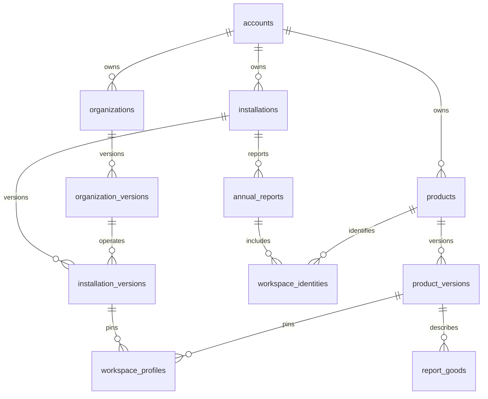

# Implemented report and master-data persistence

> Historical typed-storage reference. Migration `202610270001_compact_reports` replaces the generated form tables with JSONB revision documents. Use [the compact schema guide](CERTRACE-V2-SCHEMA.md) for the active database. These mappings remain useful for historical migration checks and current document validation.

The executable schema is [Prisma](../../certrace-backend/prisma/schema.prisma), [migration 005](../../certrace-backend/prisma/migrations/202610160005_relational_reports/migration.sql), and [migration 006](../../certrace-backend/prisma/migrations/202610160006_master_data/migration.sql). The earlier `reporting-3nf.sql` is the conceptual reference, not an additional migration to run.

## Shared identities and third normal form

Company, installation, and product facts now have shared identities and immutable versions in `masterdata`. Report inputs reference these versions through foreign keys. The old copied company names, registration/address fields, installation descriptions, product names and CN columns have been removed from the corresponding `reporting` tables. These are joins on reads, not a second master-data copy synchronized alongside the old columns.

| Relation | Key and dependent facts |
|---|---|
| `accounts`, `account_members` | Account identity and access membership. Existing accounts retain their current owner. |
| `organizations` | Stable account/company reference, independent of the company name. |
| `organization_versions` | Company name, registration, address, country and primary contact at a particular version. |
| `installations` | Stable installation reference within an account. |
| `installation_versions` | Location, representative and Registry ID at a version; operator facts are obtained through `operator_version_id`. |
| `products` | Stable catalogue or custom product reference within an account. |
| `product_versions` | Product name, CN code, description, unit and benchmark at a version. |
| `*_heads` | One current version of each shared identity. |
| `annual_reports` | One annual report identity per installation and year, enforced by a unique constraint. |
| `workspace_identities` | The existing product workspace's membership in its annual report and product identity. |

Repeating report inputs remain typed child rows. Their parent foreign keys resolve the input revision and scope. Additional company inputs, operator/exporter relationships, supplier profiles, precursor producer details, installation history, monitoring plans and goods reference the shared profiles. Workspace product/installation IDs and reporting year are reconstructed from their relationships instead of stored again as scalar copies.

A historical version intentionally retains its facts. Its attributes depend on the version key. Current editable copies of the same company or product are consolidated; historical facts are not overwritten by a later rename.

Stable IDs determine identity. Two companies are not merged because their names look similar. Catalogue products share the catalogue identity across workspaces; separately defined process goods keep their own stable local identity. Product workspaces remain distinct views under their installation/year report, preserving their existing readings and provenance.

## Saves and historical reports

1. Elysia authenticates the caller and validates the concrete input contract.
2. A Prisma transaction takes the account lock and checks expected revisions.
3. The service identifies intentional master-field edits by comparing the submitted data with the previous report view. Conflicting values for the same shared fact are rejected.
4. Shared changes propagate to all editable references. Master versions are prepared first, so related rows pin the same complete profile rather than creating partial independent copies.
5. New immutable report revisions and master references are written, sealed, and selected by their heads atomically.
6. The response includes every affected store. The browser applies the acknowledged values, preserves newer queued typing, and refreshes dependent report views.

Signed workspaces and frozen snapshots retain their pinned values. Supplier drafts use private revision keys and cannot publish master changes. A valid supplier submission applies its scoped changes through the same consolidation transaction.

The frontend keeps a working copy in memory. Report and organisation saves await the database acknowledgement. These values are not stored in localStorage.

## API

- `GET /api/v1/reporting/records`: current account report projections.
- `PUT /api/v1/reporting/records`: save one typed report store; the response includes related changes.
- `POST /api/v1/reporting/records/batch`: save related inputs atomically.
- `GET /api/v1/master-data`: current company, installation and product profiles, and annual report identities.
- `PATCH /api/v1/master-data/organizations/:id`: version-checked company edit with propagation to drafts.
- `PATCH /api/v1/master-data/products/:id`: version-checked product edit with propagation to drafts.

The compatibility account-record routes delegate report and profile keys to these services. Personal profile fields have typed columns; organisation facts reference the company master. Legacy copies of session ID/email/plan fields are removed from the profile projection because authentication owns those facts.

Eden infers frontend request types from Elysia. The additional report catalogue validates every concrete field at runtime; unknown fields are rejected. The [column catalogue](IMPLEMENTED-COLUMNS.md) maps every input path to storage, including the 276 fields in the 65 additional sections.

## Database integrity

- Account policies use the transaction's authenticated identity under the restricted `certrace_reporting` role.
- Master foreign-key guards reject references to another account, including direct SQL inserts.
- Workspace identity constraints verify the installation, annual report, product and legacy workspace reference agree.
- Master versions and sealed report revisions are immutable; changing facts creates a new version.
- Composite foreign keys keep heads attached to a version of the correct entity.
- Required profile references, installation/year uniqueness, numeric constraints, same-report references, parent deletion checks, and precursor-cycle validation protect input consistency.
- Missing, null, empty, and measured zero remain distinguishable. Quantities retain numeric columns; text drafts retain their input representation.
- Frozen report documents are output artifacts, not editable input payloads.

## Upgrade and verification

Migration 006 runs in one PostgreSQL transaction. It creates identities, backfills references for historical report rows, verifies extracted scalar values against the joined profiles, and only then removes duplicated columns. A mismatch rolls back the migration.

Run `bun run db:migrate`, then `bun run db:report-backfill` from `certrace-backend`. The backfill also runs transactionally on an account's first access. It verifies the complete typed view before removing a generic source record and retains its revision/hash receipt. Backups are taken before the local cutover.

Historically, `db:report-catalogue` checked both generated migration catalogues. The SQL generators have since been removed; the command now checks current document contracts and autofill reference data only. Deployed migrations remain immutable: future changes require a new migration, not rewriting 005 or 006. The independent `scripts/verify-master-migration.ts` compares every historical revision between a pre-upgrade database and a migrated copy using the retained read-only v005 decoder.

Verification covers all report fields, shared company/product edits across two reports, monitoring-plan goods, a single installation/year report, signed-report preservation, stale revisions, tenant isolation, direct SQL constraints, supplier submissions, migration rollback, and unchanged calculation fixtures. Browser tests exercise real form saves, reloads, another browser session, month isolation and shared master updates across report pages.

### Verified deployment — 16 October 2026

- Migration 006 applied to the local Docker database after a backup and isolated rehearsal.
- Every one of the 3 pre-existing report revisions matched its pre-upgrade view exactly using the independent v005 reader.
- Migrated the 5 legacy account profiles; all current master facts across those accounts passed the consolidation consistency check.
- Database checks found no unfinished migrations, unsealed revisions, remaining migrated generic payloads, or old workspace copies of the extracted master fields.
- Passed 17 backend integration tests, 570 frontend unit tests, both TypeScript checks, generated-schema checks, and 2 production-container browser tests.
- The browser tests verified actual Production setup edits across two reports, shared company/product identities, reload persistence, separate browser sessions, and month isolation.
- Rebuilt and restarted the three-container local stack. Port 3000 returned HTTP 200; backend and frontend-proxied readiness checks confirmed database readiness. Temporary test containers were removed.
